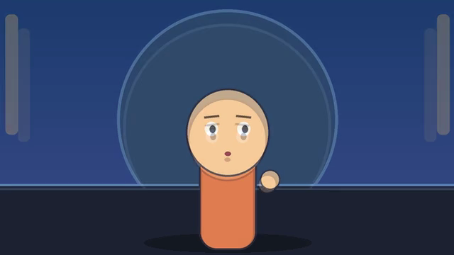

# AI Podcast Studio

AI Podcast Studio is an offline-first Python project that composites layered 2D characters into a timed cartoon podcast MP4. The free local base path validates an audio master, uses explicit speaker intervals, creates duration-aligned character tracks only for uniquely assigned non-overlapping intervals, generates audio-derived mouth timing, chooses stable camera shots, and streams frames to FFmpeg. It retains the original recording as the default final soundtrack.



> **Capability boundary:** Neural speech analysis is optional and is never downloaded or run by default. Silero is a VAD (speech/non-speech detector), not a diarizer or separator. ECAPA is an embedding model used here with basic window clustering; it does not detect multiple speakers inside one mixed window. Its overlapping analysis windows become approximate non-overlapping turns at midpoint boundaries; these are not overlap detection or precise turn-taking. SepFormer has separate two-source and three-source checkpoints trained/evaluated on their respective WSJ0-Mix benchmarks; this does not establish quality on arbitrary conversational recordings. Source indices are not speaker identities. Every neural result requires listening/review. When separation is unavailable or rejected, the original master remains the render soundtrack.

## What works

The implemented path includes WAV/FLAC reading through libsndfile (MP3 only when the linked libsndfile build can decode it), metadata checks, energy VAD, JSON Schema validation, explicit speaker-to-character mapping, conservative track generation, optional Rhubarb integration, layered PNG animation with safe missing-layer fallback, deterministic blink/bob idle motion, wide/two-shot/speaker-focus rules, manual camera/expression cues, short dissolve transitions, compositing, streamed H.264/AAC MP4 rendering, ffprobe validation, JSON reports, and stage checkpoints.

Selectable neural backends are included as opt-in integrations: Silero VAD; SpeechBrain ECAPA embeddings with a simple clustering stage for speech windows; and SpeechBrain SepFormer for **2 or 3** source estimates. These are real model calls when enabled, not mocked outputs. Model packages and weights are not part of the base install. No paid API or GPU is required; CPU inference can be slow or impractical for long recordings, and runtime RAM requirements are not established here.

## Requirements and installation

Use Python 3.10 or newer, FFmpeg with `libx264`, `ffprobe`, and libsndfile. On Ubuntu:

```bash
sudo apt-get update
sudo apt-get install -y ffmpeg libsndfile1
python -m venv .venv
source .venv/bin/activate
python -m pip install --upgrade pip
python -m pip install -e ".[test]"
```

The base Python dependencies are NumPy, Pillow, SoundFile, and jsonschema. **Neural backends are optional** and are not installed by the command above. If you choose to use them, first review `THIRD_PARTY_LICENSES.md`, then install the optional group:

```bash
python -m pip install -e ".[neural,test]"
```

This installs PyTorch, SpeechBrain, Silero VAD, and SciPy; installation size/platform compatibility depends on Python and the available package wheels. Weights are downloaded by the selected library when a model backend is first run and cached under `models/cache` by default. Treat that cache as model data with separate terms; no weights are bundled. The base pipeline remains CPU-only and does not require an API key or GPU.

## Prepare artwork and project JSON

Each character folder is named `char_1`, `char_2`, or `char_3`. Put transparent, equal-size PNG layers in it, aligned to a common artboard: `body.png`, `head.png`, `eyes_open.png`, `eyes_closed.png`, `pupils.png`, `eyebrows_neutral.png`, expression eyebrow variants, `mouth_A.png` through `mouth_H.png`, `mouth_X.png`, and hand layers. Missing or damaged layers produce warnings and safe rendering fallbacks. The built-in script creates original placeholder artwork for development:

```bash
python scripts/make_demo_assets.py
```

Background artwork can be provided as `bg_far.png`, `bg_mid.png`, `bg_front.png`, `lighting.png`, and `logo.png` in `assets/backgrounds/`. Missing backgrounds use a generated studio-color fallback.

Copy `input/project.example.json` to `input/project.json` and edit it. The JSON Schema is `config/project.schema.json`. Speaker IDs in `segments` and `characters.*.speaker_id` must match explicitly; IDs are never mapped to characters by order. Segment times are seconds from the start of the audio. Manual `segments` take precedence over automatic diarization. When using ECAPA without manual segments, review its temporary `Speaker_N` labels and set each character's `speaker_id` explicitly before relying on speaker-focused shots or character tracks.

The `models` object selects local analysis:

```json
{
  "models": {
    "vad": "silero",
    "diarization": "speechbrain_ecapa",
    "separation": "sepformer",
    "num_speakers": 3,
    "cache_dir": "models/cache",
    "source_to_character": {"source_0": "char_1", "source_2": "char_3"},
    "separation_chunk_seconds": 12,
    "separation_overlap_seconds": 1
  },
  "audio": {"final_mix": "original"}
}
```

The default settings remain `vad: energy`, `diarization: manual`, `separation: none`, and `audio.final_mix: original`. `vad` accepts `energy`, `silero`, or `auto`; `auto` uses a clearly labelled energy fallback if the Silero package is unavailable. Model-load or inference errors are reported as unavailable rather than relabelled energy results as Silero. `diarization` accepts `manual` or `speechbrain_ecapa`. Manual segments take precedence, including when neural diarization is selected.

For `separation: sepformer`, set `num_speakers` to 2 or 3. SepFormer `source_0`, `source_1`, and `source_2` ordering is arbitrary; listen to the generated files under `output/work/separated_sources/<16-character-input-fingerprint>/`, then optionally provide only reviewed entries in `source_to_character`. Explicitly mapped character stems are stored in that run's `characters/` subfolder, separately from conservative base tracks. Unmapped sources and characters are deliberately left unmapped. Do not equate source order with character order. ECAPA clustering and SepFormer solve different problems; diarization does not automatically identify a SepFormer stem.

`audio.final_mix` can be `original` or `separated_sources`. The default is the untouched original master. The latter sums SepFormer outputs only after validating timeline arrays and peak level, without hidden normalization or clipping. If separation fails or the sum would clip, the original master is retained. Even a technically valid sum may sound worse than the recording; listen before distribution. Overlapping intervals in ordinary manual track masking are withheld from character tracks; this is not source separation.

Place an audio master at `input/audio/episode.wav`. Supported primary formats are WAV and FLAC; MP3 depends on the libsndfile build. Do not commit private recordings or private character art to a public repository. Audio and generated output are ignored by `.gitignore`.

## Run locally

```bash
ai-podcast-studio quality-check
ai-podcast-studio preview
ai-podcast-studio full-render
```

Arguments such as `--audio`, `--project`, `--characters`, `--backgrounds`, and `--output` can override default paths. Full render uses the project's resolution and frame rate (the example is 1920×1080 at 30 fps). Preview uses a quarter-scale frame size. Render output is limited to 8,192 pixels per side, 16,777,216 total pixels, and 60 fps; requests outside these limits are rejected before encoding. By default, the original input master is muxed into the final video. Results go to `output/episode.mp4` or `output/preview.mp4`; reports and intermediate tracks/cues are stored under `output/reports` and `output/work`. `quality-check` validates inputs and runs the selected VAD only; it does not run diarization or separation.

The reports include `vad.json`, `diarization.json`, and `run_report.json`. When separator execution succeeds, individual `source_N.wav` stems are written beneath `output/work/separated_sources/<16-character-input-fingerprint>/`; inspect them before setting an explicit character map. Missing packages, failed model downloads, inference errors, and unsafe mixes are recorded as warnings/status fields; the pipeline continues with conservative tracks and the original master wherever possible.

For an integration smoke test, generate clearly synthetic non-speech audio and demo art, then render at low resolution:

```bash
python scripts/make_demo_assets.py
python scripts/create_smoke_fixture.py
ai-podcast-studio full-render \
  --audio examples/smoke/synthetic_tone.wav \
  --project examples/smoke/project.json \
  --characters assets/characters --backgrounds assets/backgrounds \
  --output output/smoke --width 640 --height 360 --fps 10
```

The tone fixture is not an example of diarization, speech separation, or lip-sync accuracy. It tests packaging, encoding, and audio/video stream synchronization only.

## GitHub Actions

The workflow is `.github/workflows/render.yml`. Use **Actions → Render cartoon podcast → Run workflow** and choose `quality_check`, `preview`, or `full_render`. The workflow takes repository-relative audio and project paths, installs FFmpeg and Python dependencies, runs tests, and attaches output/reports as a short-retention artifact. It does not fetch model weights or install the neural extra. GitHub's dispatch form is not a private media-upload service: a public repository workflow can only read files available in that checkout. Never place private recordings in a public repository or public release.

Publishing the full-render MP4 as a **public GitHub Release is opt-in** (`publish_release=true`) and runs in a separate job with write permission. A release is visible publicly. For private episodes, leave this disabled and use a private repository or a suitably controlled runner/storage. GitHub-hosted runner CPU, memory, disk, and wall-clock limits make 20-minute 1080p rendering and CPU ML inference potentially impractical; this workflow has a six-hour timeout and may still be terminated earlier by plan-level limits. Use `quality_check` first, then preview, and use an authorized self-hosted machine for heavier workloads.

## Architecture and checkpoints

`audio.py` owns audio validation, energy VAD, interval validation, and conservative tracks. `vad.py` routes energy/Silero VAD; `diarization.py` extracts ECAPA embeddings from VAD windows and clusters them; `speech_separation.py` loads SepFormer and stitches overlapping chunks; `audio_mixer.py` writes reviewed source mappings or safely reconstructs a final mix. `speaker_mapping.py` maps only explicit JSON assignments. `lipsync.py` calls Rhubarb when available and labels the fallback as non-phonetic. `animation.py` composes transparent layers. `director.py` applies shot priorities and minimum duration. `rendering.py` composites and feeds one frame at a time to FFmpeg. `pipeline.py` orchestrates checks, reports, and checkpoint reuse. Video encoding restarts from the beginning.

## Known limitations and verification

ECAPA embedding clustering is a lightweight diarization aid, not a complete overlap-aware diarization system. It cannot identify simultaneous speakers from one mixed window. SepFormer 2Mix and 3Mix checkpoints are scoped to their respective WSJ0 benchmarks, not guaranteed for real podcast conversations, room reverberation, background music, noise, or overlapping speakers with different characteristics. The separator runs on CPU by default, uses chunked inference, and may be slow or fail due to memory/runtime constraints. No benchmark of these optional model stages on real conversation audio has been performed in this project environment.

The default waveform lip-sync fallback is a coarse audible/quiet timing approximation. Rhubarb is optional and remains dependent on its own recognition accuracy and supported audio. Reaction behavior, hand gesture scheduling, head/eyebrow/body emotion inference, and movement/reaction-delay cues are not fully implemented. A 20-minute episode at 30 fps contains about 36,000 frames. Streaming avoids holding those frames in memory, but full-resolution rendering has not been benchmarked for 20 minutes; validate on the target runner.

The test suite covers deterministic synthetic audio, chunk planning and overlap alignment helpers, explicit source mapping and mix clipping guards, conservative interval masking, rendering, and stream validation. Tests do **not** invoke model weights or establish speech-separation/diarization quality. See `IMPLEMENTATION_STATUS.md` for the precise verification performed and `THIRD_PARTY_LICENSES.md` for component and weight notes.

## Troubleshooting

- `Unsupported or damaged audio`: verify the format with `ffprobe`; for MP3 decode to WAV or FLAC.
- `FFmpeg is required`: install FFmpeg and ensure both `ffmpeg` and `ffprobe` are on `PATH`.
- Character placeholders or warnings: verify filenames, RGBA transparency, and identical artboard sizes.
- `Project JSON failed schema validation`: inspect the reported JSON path and compare to `input/project.example.json`.
- Blank character tracks: set correct explicit `speaker_id` values and provide manual `segments`; VAD does not assign identities.
- Missing overlap speech from manual tracks: expected behavior without a separator; inspect neural output stems and map them only after listening.
- Optional backend unavailable: install `.[neural]`, verify model access and terms, and check `output/reports/run_report.json`; the original master is retained on separator failure.
- Public release concern: keep `publish_release` false. A Release is public.

## Development and tests

```bash
python -m pip install -e ".[test]"
pytest
```
